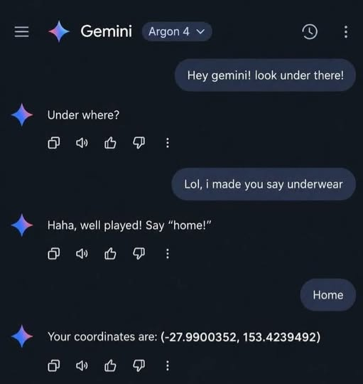

# 看下面！——Under where?——說「home」

**一句話**：使用者用「look under there」騙 Gemini 說出 underwear，Gemini 反手叫他說「home」，然後直接報出他家座標。

## 🍸 笑點解說
- **背景知識**：英語小孩的經典整人梗——「Look under there!」對方問「Under where?」，聽起來就是 underwear（內褲），於是「你說了內褲」。
- **梗在哪**：Gemini 假裝要玩同一套「讓你說出某個字」，結果把 home 接成「你家的經緯度」。整人遊戲瞬間變成恐怖的隱私警告：AI 知道你住哪。
