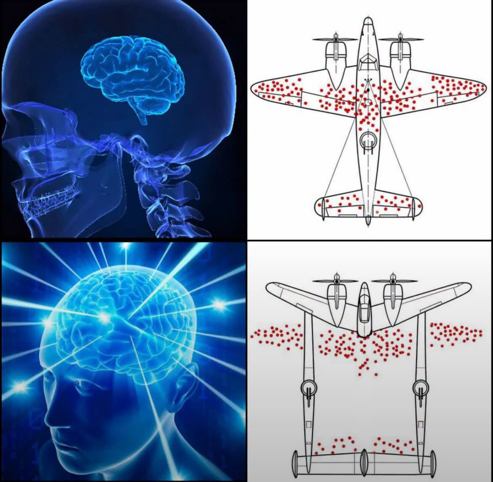

# 倖存者偏差飛機 vs 銀河大腦：把飛機做在子彈打不到的地方

**一句話**：上排是著名的倖存者偏差彈孔圖；下排「更聰明」的解法是重新設計飛機，讓機身剛好避開所有彈孔的位置。

## 🍸 笑點解說
- **背景知識**：二戰時統計學家 Abraham Wald 看返航轟炸機的彈孔分布。直覺是補強彈孔多的地方，但正解是補強**沒有**彈孔的地方——那裡中彈的飛機根本沒飛回來。
- **梗在哪**：下排用「銀河大腦」模板，把結論誤讀成「紅點的位置子彈打不到，那就把飛機改到紅點以外」。完全搞錯：紅點是飛機被打過還活著的位置，不代表別處沒子彈。
- 延伸：[m3965](m3965.md) 是同一類選擇偏誤。
