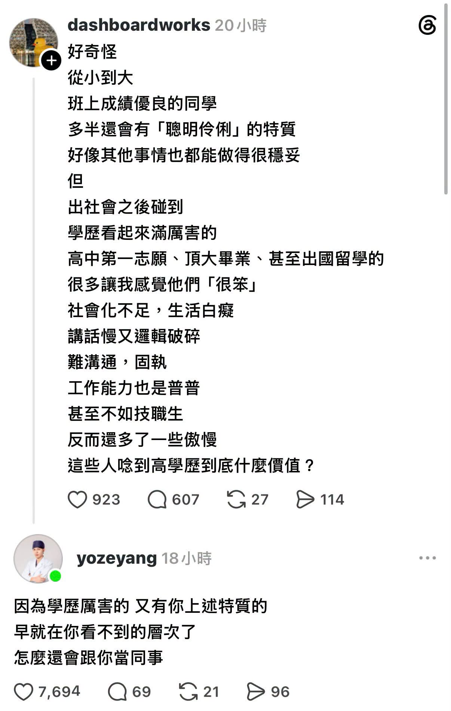

# 學歷好又聰明的人，早就在你看不到的層次了

**一句話**：原 PO 抱怨出社會碰到的高學歷同事都很笨；回覆：學歷好又有你說的那些特質的，早就在你看不到的層次了，怎麼會跟你當同事。

## 🍸 笑點解說
- **梗在哪**：回覆一句話點破樣本有問題——能被原 PO 碰到的「高學歷同事」，已經先被篩掉了最厲害的那群。順便暗示原 PO 自己的層次。
- 延伸：統計上叫伯克森悖論（Berkson's paradox）／選擇偏誤：只看經過篩選的樣本，兩個本來無關甚至正相關的特質會看起來負相關。同類梗見 [m3962](m3962.md)。
