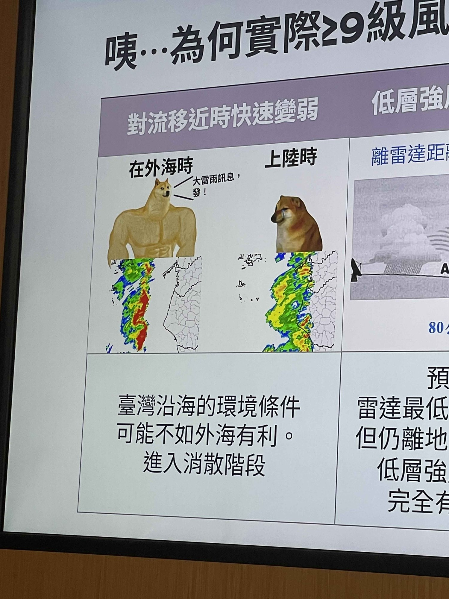

# 對流在外海時：大雷雨訊息，發！——上陸時：

**一句話**：氣象簡報拿肌肉狗 vs Cheems 解釋：對流在外海又強又猛，害預報員發了大雷雨訊息；一上陸就快速變弱。

## 🍸 笑點解說
- **背景知識**：雷達上外海一條強回波帶（紅色）逼近時，會發「大雷雨即時訊息」；但臺灣沿海的環境條件可能不如外海有利，對流移近陸地時就進入消散階段。
- **梗在哪**：用「肌肉狗 Doge vs 哭哭 Cheems」模板——在外海時是猛男，上陸時只剩可憐小狗。這是投影片原本的內容，連官方簡報都在用梗圖解釋「為什麼實際風雨沒有預期大」。
