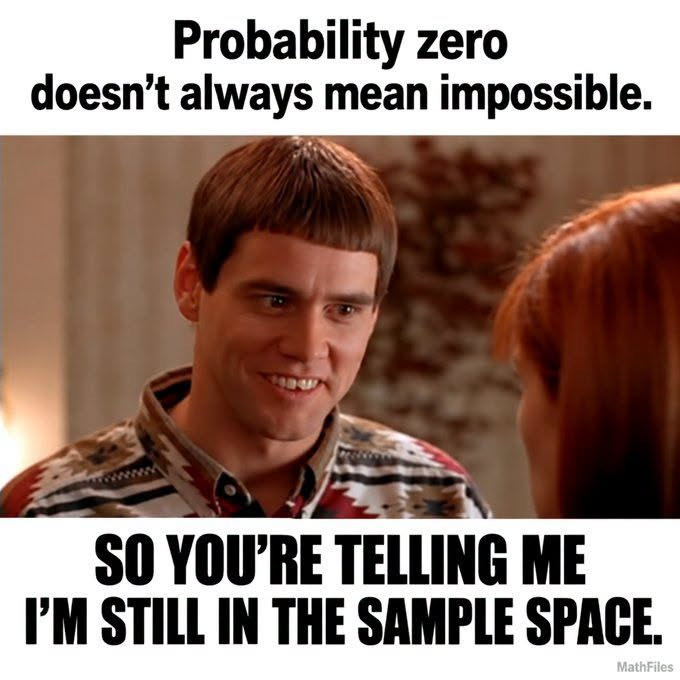

# AI 模型排行：名字字母數

**一句話**：模仿 AI 跑分長條圖，比的是模型名稱有幾個英文字母：Gemini 4 Argon 11 個奪冠，Claude Opus 5.5 以 10 個居次。

## 🍸 笑點解說
- **梗在哪**：各家發表新模型都愛秀跑分長條圖，這張改比完全無意義的「名字字母數」。真的有照算：數字和空格不算，Claude Opus 是 6+4=10、Grok 只有 4。
