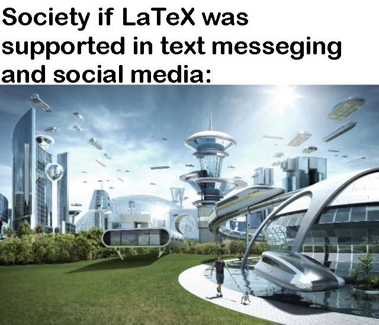

# Vibe coding 最終魔王：create windows12 and make no mistakes

**一句話**：深夜打開 Claude，只輸入一句「create windows12 and make no mistakesd」。

## 🍸 笑點解說
- **梗在哪**：網路流行在提示詞最後加「make no mistakes」，彷彿這樣 AI 就不會出錯；這位直接要它從零寫出整個作業系統，而且連「mistakes」自己都打錯了。
