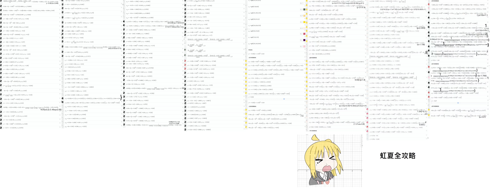
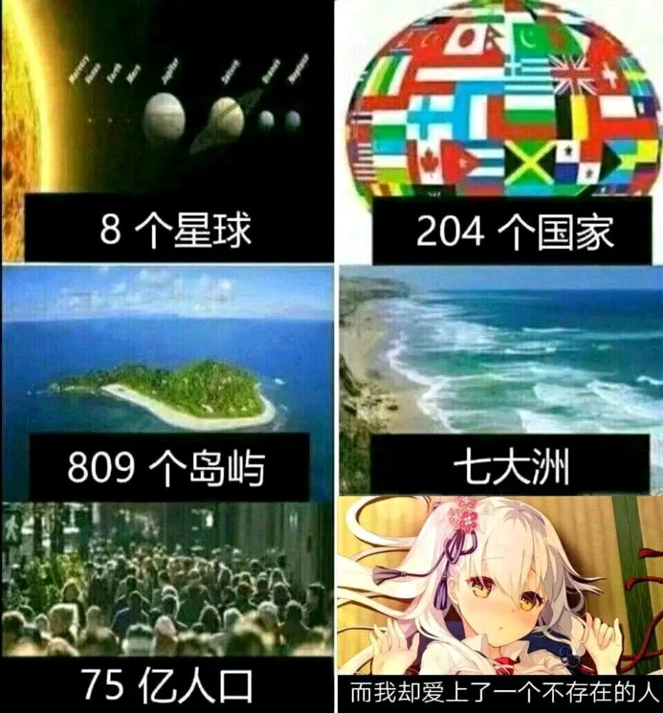
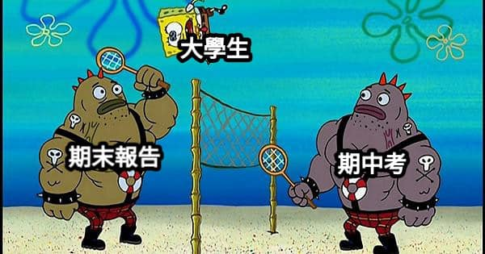
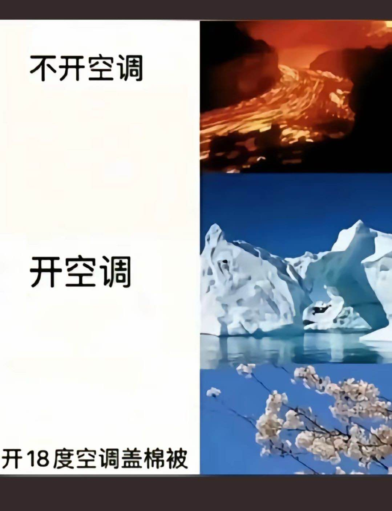
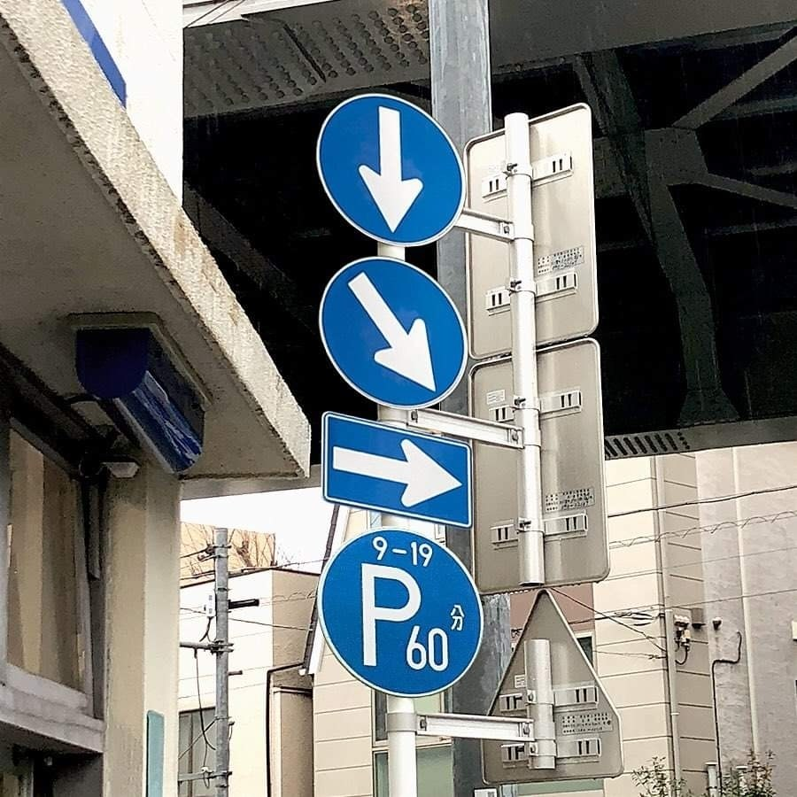
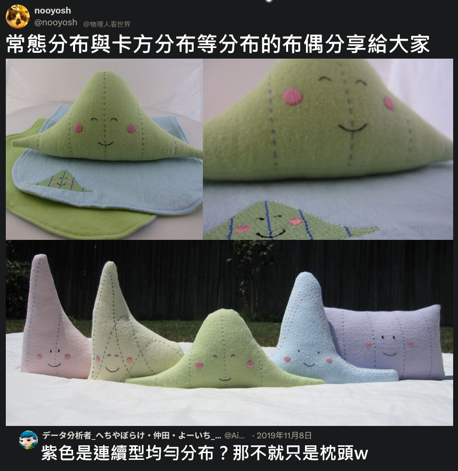
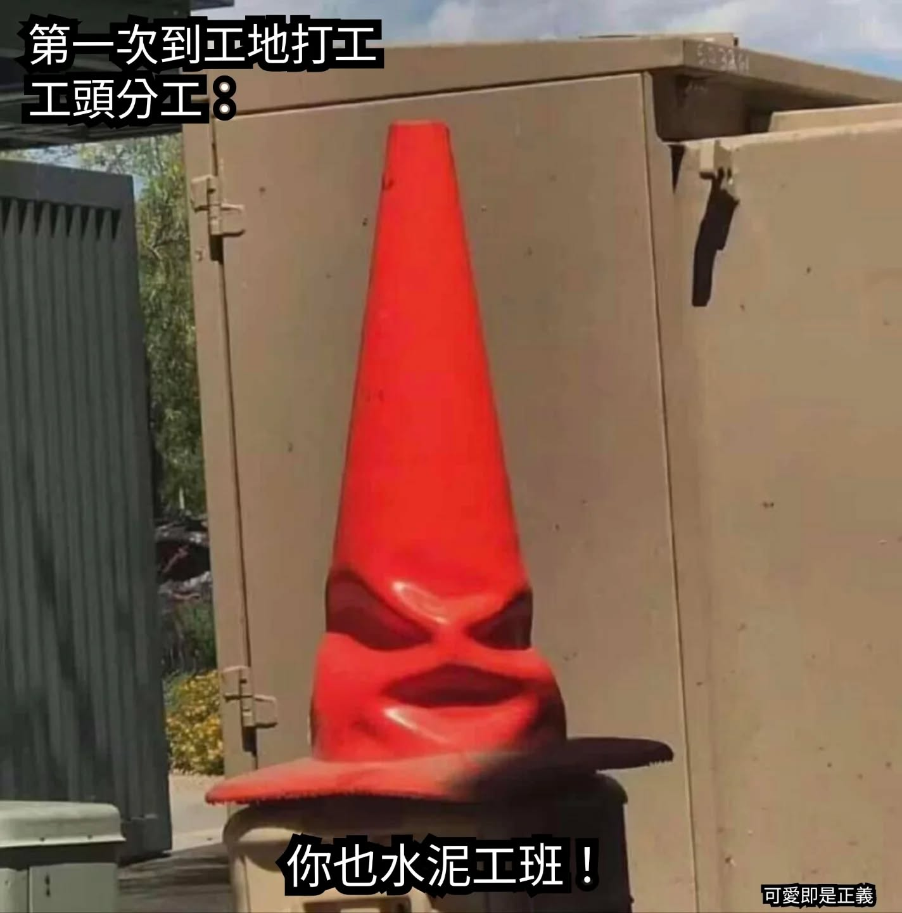
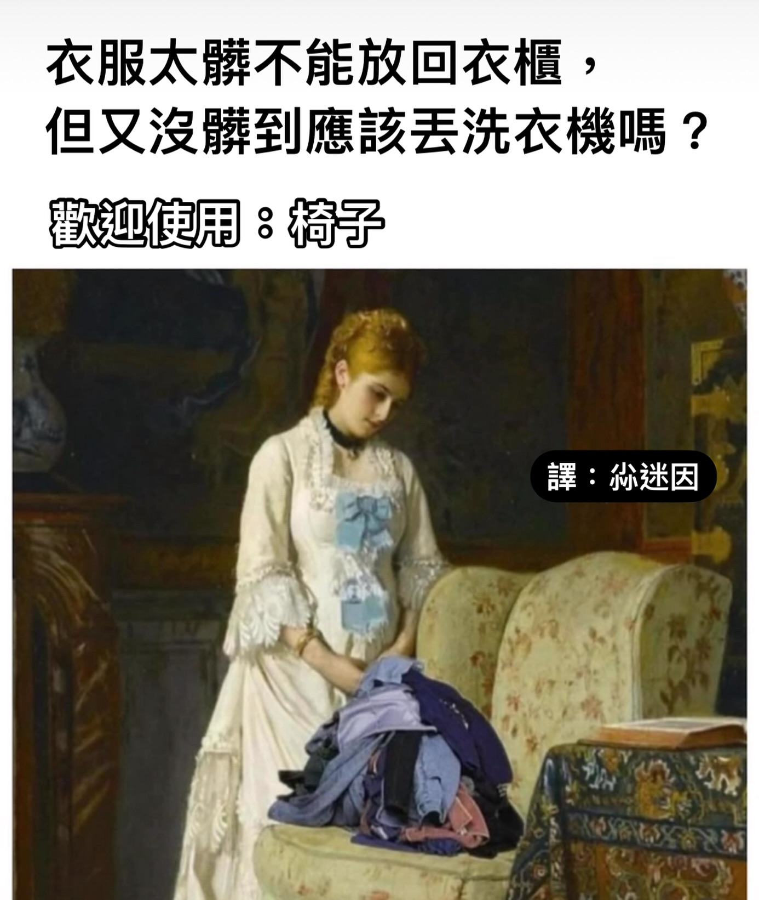
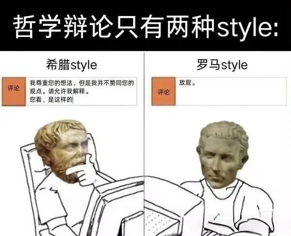

<!-- 此檔由 tools/build_menu.py 自動生成，請勿手動修改 -->

# 🎲 調酒師今日精選

[⬅ 回酒館大廳](../README.md) ・ [📋 總表](index.md) ・ [🏷️ 標籤](tags.md) ・ [🍸 看不懂專區](explained.md)

> 🌐 **每日自動刷新版 → [https://derek1403.github.io/meme_Bistro/](https://derek1403.github.io/meme_Bistro/)**（依台灣日期每天換一批，可翻看前後日、依主題篩選）

以下是靜態備份：每次執行 `tools/build_menu.py` 會依當天日期（2026-10-25）隨機抽出 12 杯，不含需斟酌的內容。

<table>
<tr>
<td align="center" valign="top" width="33%"> <a href="../memes/m2611.md">麥當勞為什麼從歡樂變得這麼抑鬱？</a> 👀 ★</td>
<td align="center" valign="top" width="33%"> <a href="../memes/m3059.md">虹夏全攻略：用幾百條方程式畫出來</a> 👀 ★★</td>
<td align="center" valign="top" width="33%"> <a href="../memes/m3525.md">8 個星球、204 個國家、75 億人口，而我卻愛上了一個不存在的人</a> 👀 ★</td>
</tr>
<tr>
<td align="center" valign="top" width="33%"> <a href="../memes/m2862.md">期末報告和期中考在打羽毛球，大學生是那顆球</a> 👀 ★</td>
<td align="center" valign="top" width="33%"> <a href="../memes/m1831.md">不開空調 vs 開空調 vs 開 18 度空調蓋棉被</a> 👀 ★</td>
<td align="center" valign="top" width="33%"> <a href="../memes/m2526.md">程式課打瞌睡：9:10 → 9:05</a> 👀 ★</td>
</tr>
<tr>
<td align="center" valign="top" width="33%"> <a href="../memes/m3540.md">路標排出波動拳指令：↓↘→P</a> 👀 ★★</td>
<td align="center" valign="top" width="33%"> <a href="../memes/m0642.md">常態分布與卡方分布布偶</a> 👀 ★</td>
<td align="center" valign="top" width="33%"> <a href="../memes/m0516.md">你也水泥工班！</a> 👀 ★</td>
</tr>
<tr>
<td align="center" valign="top" width="33%"> <a href="../memes/m1356.md">衣服太髒不能放回衣櫃、又沒髒到該洗——歡迎使用：椅子</a> 👀 ★</td>
<td align="center" valign="top" width="33%"> <a href="../memes/m1133.md">哲學辯論的兩種 style：希臘 vs 羅馬</a> 👀 ★</td>
<td align="center" valign="top" width="33%"> <a href="../memes/m0029.md">我比較喜歡正面回饋</a> 🔤 ★</td>
</tr>
</table>
